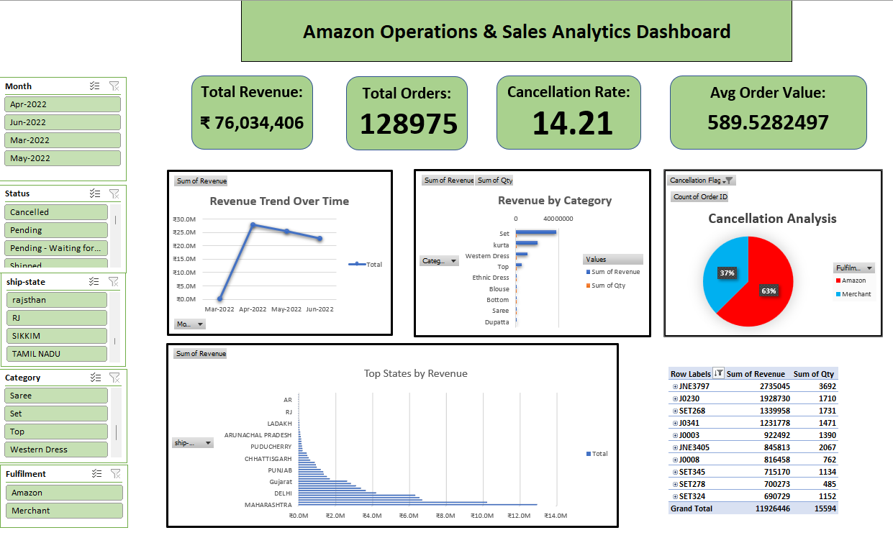

# 📦 Amazon Operations & Sales Analytics Dashboard (Excel)

A small number of product categories generated the majority of revenue, while operational factors such as fulfillment method and order cancellations had a measurable impact on overall business performance.

This project was built to answer a simple business question:

> **How can an Amazon seller increase revenue while reducing operational inefficiencies?**

---

## Dashboard Preview

### Executive Dashboard



---

## Project Overview

I've analyzed Amazon sales and fulfillment data using Microsoft Excel to uncover revenue, operationas, and growth opportunities.

Rather than focusing only on visualization, the goal was to approach the dataset like a business analyst:

* Identify what drives revenue
* Understand cancellation behavior
* Evaluate fulfillment performance
* Analyze geographic sales distribution
* Generate actionable recommendations

---

## Business Questions Solved

### Revenue Performance

* Which categories generate the most revenue?
* How does revenue trend over time?
* Which products contribute the most sales?

### Operational Performance

* What percentage of orders are cancelled?
* Does fulfillment method impact operational outcomes?

### Geographic Analysis

* Which states generate the highest revenue?
* Where should growth efforts be focused?

### Product Analysis

* Which categories dominate sales?
* Which sizes perform best?
* Which SKUs contribute most revenue?

---

## Dataset

The dataset contains Amazon order-level sales records, including:

* Order ID
* Order Date
* Fulfillment Method
* Product Category
* SKU
* Size
* Quantity
* Revenue (INR)
* Shipping State
* Order Status
* B2B Indicator

---

### Data Preparation

* Data Cleaning
* Duplicate Removal
* Filtering & Validation

### Analysis

* Pivot Tables
* Pivot Charts
* Slicers
* KPI Development
* Conditional Analysis

---

## Key Findings

### 📈 Revenue Concentration

The **Set** and **Kurta** categories generated the largest share of revenue, indicating strong product-market fit and inventory priorities.

---

### 🚚 Fulfillment Performance

Cancellation analysis revealed meaningful differences between fulfillment methods.

This insight can help operations teams evaluate logistics performance and reduce revenue leakage from cancelled orders.

---

### 🌎 Geographic Performance

Revenue is heavily concentrated in a small number of states.

States such as **Maharashtra** and **Karnataka** consistently contributed the highest sales activity.

This information can support:

* Regional inventory planning
* Marketing allocation
* Expansion strategy

---

### 📦 Product Strategy

Sales volume is concentrated among a relatively small set of SKUs and product categories.

Understanding these patterns helps businesses:

* Optimize inventory
* Reduce stock inefficiencies
* Improve forecasting accuracy

---

## Recommendations

### 1. Focus on High-Revenue Categories

Allocate more inventory and marketing resources toward top-performing categories such as Set and Kurta.

### 2. Investigate Cancellation Drivers

Analyze operational causes behind cancelled orders and fulfillment-related performance gaps.

### 3. Prioritize High-Performing Regions

Use geographic sales concentration to guide future growth initiatives.

### 4. Improve Inventory Planning

Leverage size and category demand patterns to optimize stock allocation.

---

## Project Structure

```text
Amazon_Analytics_Dashboard/
│
├── Amazon Sales Performance & Fulfillment Analysis.xlsx
├── Raw_Amazon_Data.xlsx
├── README.md
│
└── screenshots/
    ├── dashboard_overview.png
    ├── revenue_category_analysis.png
    ├── cancellation_analysis.png
    └── top_states_analysis.png
```

---

## 👤 Author

**Atik Riad**
📧 [azrofficial20@gmail.com](mailto:azrofficial20@gmail.com)
🔗 [LinkedIn](https://www.linkedin.com/in/atikzamanriad/)
